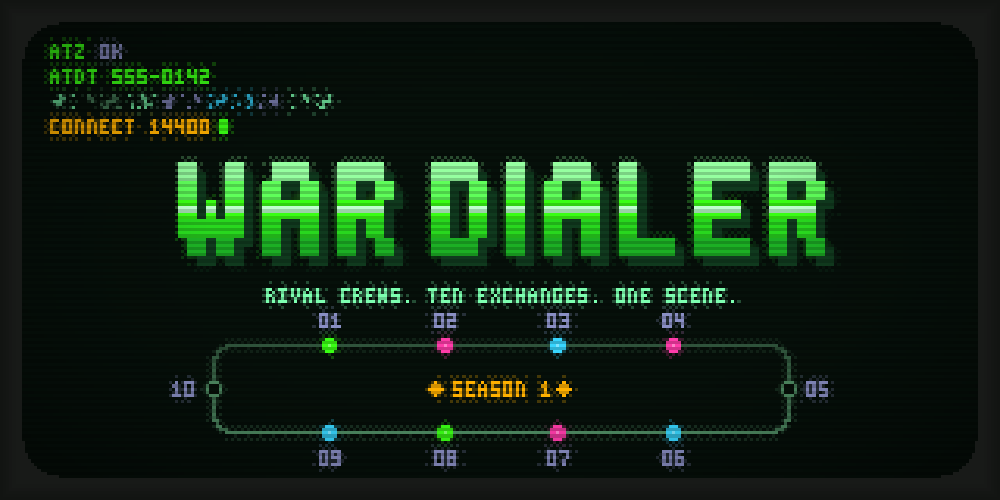

# War Dialer

An asynchronous multiplayer door game for BBSes: rival crews compete for ten
phone exchanges across a season, in one shared world that every caller on the
board plays.

War Dialer is one Python file, `war_dialer.py`, with no dependencies beyond
Python 3.11's standard library. It needs a terminal of at least 40 columns by
12 rows. Every caller on one BBS shares one SQLite world.

The game was extracted byte-for-byte from NetBBS main after its administration
prerequisite ([NetBBS #1227](https://github.com/Thiesi/NetBBS/issues/1227)).
See the [migration provenance](docs/migration.md) for the source commit and hash.
NetBBS still ships its bundled copy.

## World and administration

Set `WAR_DIALER_DB_PATH` to an absolute world filename shared by all the nodes
of one BBS. NetBBS supplies its caller metadata through `NETBBS_DOOR_INFO`.
Without a host token, the first launch gives the world a random persistent
owner ID and marks it self-owned. Existing unbound standalone worlds are
adopted the same way. A NetBBS-bound world still requires its matching host
token on every launch. Use a separate world for each BBS.
Keep the world, its WAL files and its `.sessions` guard together; backups must
use SQLite's backup API, not a copy of a live `.db` file.

Administration needs no caller drop file:

```sh
python war_dialer.py --world /var/lib/wardialer/world.db --admin status --json
python war_dialer.py --world /var/lib/wardialer/world.db --admin maintenance on
python war_dialer.py --world /var/lib/wardialer/world.db --admin close-season \
  --confirm world.db --reason "Start the next competition"
python war_dialer.py --world /var/lib/wardialer/world.db --admin maintenance off
```

`reset` also clears receipts while retaining player identities, account age,
world ownership and the latest 100 audit entries. Both destructive commands
require maintenance on, the exact filename and a reason. They first create a
SQLite-consistent snapshot beside the world; `--snapshot` can name a different
new file. Existing snapshot files are refused. Maintenance stays on afterward.
Active game sessions prevent maintenance operations. NetBBS additionally
requires its own verified complete node backup through its wrapper.

## NetBBS game events

Under NetBBS `door_api` 5 with game events switched on for this door
(`outbound.events` in `door_info.json`), War Dialer reports what callers earn
live. NetBBS's bot then announces it in chat and answers `!top wardialer`:

| Event | When |
|---|---|
| `rank` | The caller reaches a new Rank tier during the session |
| `medal` | A season closes; gold, silver and bronze, from the session that archives it |
| `capture` | The caller captures an exchange |
| standings | The current season's top ten changes, and an empty table after a season reset |

Each request is renamed into the drop directory only after its action
commits. Nothing earned offline or in an earlier session is reported. Without
`outbound.events` (another host, standalone play, or events switched off),
the door writes nothing.

## Classic host setup

Pass the caller's drop-file **filename**, quoting paths with spaces:

```sh
python3 /opt/doors/wardialer/war_dialer.py /path/to/node/DOOR.SYS
```

DOOR32.SYS and DOOR.SYS accept CRLF or LF and use the numeric caller record
number, so an alias change preserves the player. Renamed files are recognized
by their contents. NetBBS's `NETBBS_DOOR_INFO` takes precedence whenever it is
set. A malformed drop file stops the launch without creating a Guest player.
Classic ANSI callers get the 16-color palette; standalone branding is neutral.
Classic drop files default to CP437 output; a standalone launch defaults to
UTF-8. In Display, Encoding cycles Automatic, UTF-8 and CP437 independently
of the other preferences, and survives season/competition resets. NetBBS
always receives UTF-8 and converts for its caller, so its encoding is managed.
Saved names remain Unicode; unsupported display characters are transliterated
without changing their column width. All input is single-key menus.
DOOR32 communication type 2 uses the inherited socket handle on Windows or
file descriptor on POSIX for all game input and output. The host must pass
that connection to the Python process; merely copying a drop file does not
pass its socket. Other launches use stdin/stdout. The door filters telnet
commands, escapes output IAC bytes, and accepts CR NUL or CR LF as Enter.
Carrier loss exits cleanly: an unconfirmed action spends nothing, and an
already committed action remains committed.

Use one absolute `WAR_DIALER_DB_PATH` shared by every node of **one BBS**,
outside its per-caller temporary directories. Different BBSes need separate
worlds because their caller numbers overlap. For example, a Unix launcher:

```sh
#!/bin/sh
export WAR_DIALER_DB_PATH=/var/lib/wardialer/world.db
exec /usr/bin/python3 /opt/doors/wardialer/war_dialer.py "$1"
```

Make the launcher executable and give the BBS account write access to the
world directory. These setup recipes await the real-host validation in #6:

| Host | Stdio setup |
| --- | --- |
| Synchronet on Linux | In SCFG Online Programs, select Native Executable, Standard I/O, DOOR.SYS and drop files in the Node Directory. Command: `/opt/doors/wardialer/launch.sh "%f"`. |
| Mystic on Linux/macOS | Use the `DD` external-program menu command with `/opt/doors/wardialer/launch.sh "%PDOOR.SYS"`; `%P` includes the trailing slash. |
| ENiGMA½ | Use its `abracadabra` menu module with the configuration below. |

```hjson
config: {
    name: War Dialer
    dropFileType: DOOR
    cmd: /usr/bin/python3
    args: [ "/opt/doors/wardialer/war_dialer.py", "{dropFilePath}" ]
    io: stdio
    encoding: cp437
    env: { WAR_DIALER_DB_PATH: "/var/lib/wardialer/world.db" }
}
```

The `--admin` commands above work without a drop file. Host references:
[Synchronet](https://wiki.synchro.net/ref:door.sys),
[Mystic external programs](https://wiki.mysticbbs.com/doku.php?id=menu_commands),
[ENiGMA½ native doors](https://enigma-bbs.github.io/doors/scripts-and-binaries/).

## Development

```sh
python -m pip install pytest pytest-xdist tzdata
python -m pytest -q -n auto
python -m pytest -q -m timing_sensitive
python -I tools/check_stdlib_only.py
python tools/door_gallery.py --open
python tools/cp437_gallery.py --out build/cp437-gallery
python scripts/war_dialer_balance.py --help
```

The gallery drives the real door and renders its screens at 132/80/64/40
columns with the ANSI emulator in `tools/ansi_to_html.py`, including the launch
splash on Windows pipes. 132x40 is the wide console: from 100 columns, screens
are centred and up to 104 columns wide. Sockets use `select` and Windows pipes use `PeekNamedPipe`
to leave typed-ahead keys untouched and skip the splash. A screen change
needs visual review as well as layout tests.
The CP437 gallery runs the complete encoding-test screen walk through the
production byte encoder and ANSI emulator, including 40/64/80-column layouts.
`tzdata` supplies named timezone data for tests on Windows; it is not a door
import dependency. Without system timezone data, the door falls back to UTC.

The [design](docs/design.md) and [engineering notes](docs/engineering-notes.md)
carry the game's decisions from NetBBS. Older source comments and those
documents refer to NetBBS issues; imported commit messages qualify those
references as `Thiesi/NetBBS#N`. Host runtime, resize, administration-wrapper
and node-backup tests remain in NetBBS.

## Releases

Tags matching `v*` run the suite on Linux and Windows with Python 3.11 and
3.13, then publish the tagged `war_dialer.py` byte-for-byte with `SHA256SUMS`.
The release job waits for all four test combinations to pass.

Each release also ships `netbbs.json` (from `profiles/`), a NetBBS door profile
for **[J] Import JSON**, so a SysOp can run a newer release than the one their
NetBBS bundles. Replace its `WAR_DIALER_DB_PATH` placeholder with the node's
own `<node>.db.doors/war-dialer.db`, which keeps the world in the node backup
and shared with the bundled copy, and check `executable_path` (the Python 3.11+
interpreter) and `install_dir` (where `war_dialer.py` lives) for your host. The notes open with a **NetBBS:** line: when
`WORLD_SCHEMA_VERSION` is unchanged since the previous tag the release runs on
`NETBBS_MIN` (set in the release workflow) or later; when it changes, wait for
the NetBBS release that bundles it.

The presentation is designed for wide, truecolor, Unicode terminals and degrades
through 256 and 16 colors, CP437 and ASCII (see the [design](docs/design.md),
"Carrier Detect"). Pixel art uses quarter blocks; set `DOOR_PIXELS=half` for a
font without them. NetBBS's `quadrants: false` does the same.

The banner is drawn from the game's own launch splash by `art/render_banner.py`
(`python art/render_banner.py war_dialer.py art/banner.png`).

## License

BSD 2-Clause, see [LICENSE](LICENSE).
